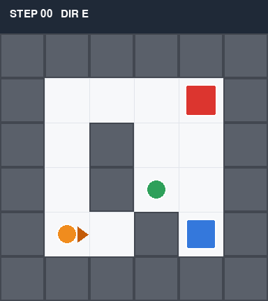

# Sim-VLM-Agent

基于视觉大模型的仿真具身智能原型。**感知 → 规划 → 行动**闭环，全程跑在本地，不需要真机。

一个 6×6 的网格房间里有一台小机器人（橙色圆）和一个红色方块。机器人只能看到当前一帧截图，
它要自己找到红块、绕开墙走过去、把它抓起来。出生点、朝向与内部隔墙**每次运行随机生成**
（`--seed <n>` 可复现某次布局，种子记录在 `summary.json` 的 `world.seed`），考验的是
对没见过地图的泛化，而不是背路线。



一次真实在线运行（glm-4v-flash 视觉 + glm-4-flash 规划）：17 步完成抓取，观察一致率 100%，
总耗时 53 秒。逐轮细节见 `runs/<时间戳>/report.html`。

```
截图 → VLM 感知 → 与本体状态融合 → LLM 规划(Function Calling) → 环境执行 → 落盘 → 下一轮
        ↑                                                              │
        └────────────────────── 环境状态更新 ←────────────────────────┘
```

## 为什么房间只有 6×6

不是为了省事，是被感知精度逼出来的。视觉模型只可靠到「画面九宫格」——让它数更细的
网格（5×4）实测准确率掉到 8%，比九宫格还差。而九宫格落在 6×6 的房间上，一格正好是
2×2 个格子，区域之间的相对向量才有 1~2 格的分辨力，闭环才拿得到有效反馈。

最早的版本是 9×7：目标的九宫格区域恒定不变，视觉实际上没有提供任何新信息，
机器人在离目标两格的地方就失去了梯度，24 步也走不完。

## 快速开始

需要 Python 3.10+。

```bash
pip install -r requirements.txt

# 1. 先确认环境本身能跑（不调用任何模型，约 0.1 秒）
python run.py --offline

# 2. 配模型：把 .env.example 复制成 .env，填 LLM_API_KEY
#    智谱的 glm-4v-flash（视觉）和 glm-4-flash（规划）都免费
python scripts/check_models.py     # 自检两个模型是否可用

# 3. 跑完整闭环
python run.py

# 想实时看画面
python run.py --render

# 复现某次运行的地图布局（种子见 summary.json 的 world.seed）
python run.py --seed 123456
```

跑完会生成 `runs/run_<时间戳>/`，里面有 `report.html`（逐轮轨迹，直接浏览器打开）、
`run.gif`（整段过程）、`trace.jsonl`（每轮原始数据）。

## 模块划分

| 模块 | 文件 | 职责 |
|---|---|---|
| 仿真环境 | `world.py` | 网格世界、碰撞检测、动作执行、截图、任务判定 |
| 视觉感知 | `perception.py` | 调 VLM，输出结构化观察；与真值对账 |
| 规划决策 | `planner.py` | 调 LLM，Function Calling 产出动作；动作校验层 |
| 主循环 | `loop.py` | 串联四步、降级策略、打转检测 |
| 轨迹 | `trace.py` | 每轮截图与 JSONL、HTML 报告、GIF |

## 关键设计：每层只做自己擅长的事

这一版的分工是踩坑之后才定下来的，不是一开始就想清楚的。

| 需要的信息 | 由谁产生 | 原因 |
|---|---|---|
| 画面里有没有红色方块、在哪个区域 | **VLM** | 纯视觉判断，不需要任何视角变换 |
| 机器人朝向、前方是否贴墙、距离档位 | **环境侧（本体感知）** | 真实机器人靠里程计和近距离传感就能知道，让模型去猜只会更差 |
| 目标在左前还是右后 | **程序做几何换算** | 以自身为原点的坐标变换，视觉模型做不准 |
| 这一步该做什么 | **LLM + Function Calling** | 决策，以及工具调用的格式约束 |

早期版本让 VLM 直接回答「目标相对我朝哪个方向」，实测 `glm-4v-flash` 在 8 帧里错 6 帧：
它读不准机器人的朝向箭头，也做不好视角变换。后来还发现它会**把橙色的机器人本体当成物体**，
把 `target_region` 填成机器人的位置——因为在 prompt 里我用「橙色圆」来描述机器人，等于亲手递了个干扰项。

改成「VLM 只负责找红块在画面哪个区域」之后，观察才稳定下来。这段弯路本身比结论更值得记：
**不要把几何推理交给不擅长它的模型。**

## 四道防线

模型不可靠是前提，不是意外。所以链路上有四处拦截：

1. **轮次上限**（`MAX_STEP`）：无论如何不会无限循环。
2. **观察校验**：把 VLM 说的物体颜色与地面真值对账，多报是幻觉、少报是漏检；方位偏差超过一档判为不可信。
3. **动作校验层**（`planner._guard`）：模型输出与观察直接矛盾时纠正它。例如「目标已在正前方、前方无墙，却要转向」会被改成前进，纠正记录写进轨迹。
4. **打转检测**：进展 = 位置变化或出现新的 (位置,朝向) 状态。真打转（原地转圈/来回踱步）状态必然周期性重复，判定后由离线规划器（BFS）接管一步把局面带开；本步计划是「可执行的前进」时直接放行——三面被堵时「转 2~3 次再前进」的正常寻路不会被误伤（`--stuck old` 可退回旧的「连续 3 步位置未变」判据做对照）。验证见 `scripts/verify_stuck_detector.py`。

第 3 条是实测逼出来的：`glm-4-flash` 会给出「目标在 front，所以需要左转把它转进前半球」这种自相矛盾的决策，
加决策表、加强措辞都没用，只能在代码层判死。

## 配置

`.env`（不提交到 git）：

```ini
LLM_API_KEY=你的key
LLM_BASE_URL=https://open.bigmodel.cn/api/paas/v4
VLM_MODEL=glm-4v-flash
LLM_MODEL=glm-4-flash
MAX_STEP=24
TIMEOUT=60
OFFLINE=0
```

任何 OpenAI 兼容接口都能换：把 `LLM_BASE_URL` 和两个模型名改掉即可。
不填 key 也能跑，`OFFLINE` 会自动置为 1，改用离线规划器，用于验证环境本身。

## 实测结果

见 `docs/实验记录.md`。原始轨迹在 `runs/` 下，`python scripts/inspect_trace.py` 可以把最近一次的
每轮观察、方位、动作打成表格，定位「模型为什么走错」。

## 已知局限

- 只能跑通单目标任务（找红块），换任务要改 prompt 和任务判定。
- 2D 网格、无物理引擎，移动是离散的格子跳转，不涉及动力学。
- VLM 对画面区域的判断在三分边界附近会摆动，靠融合与校验兜住，没有做多帧投票。
- 打转兜底用的是 BFS 离线规划，等于在模型失效时引入了「标准答案」，演示时应当说明这一点。

## 目录结构

```
sim-vlm-agent/
├── .env.example        配置模板（复制为项目根目录的 .env 并填入 LLM_API_KEY）
├── .env                本机真实配置，含密钥，已被 .gitignore 排除
├── sim_vlm_agent/
│   ├── config.py       .env / 环境变量，缺 key 自动离线
│   ├── world.py        仿真环境（出生点/朝向/内墙随机生成，BFS 保证可解）
│   ├── perception.py   VLM 感知 + 融合 + 校验
│   ├── planner.py      LLM 规划 + Function Calling + 动作校验
│   ├── loop.py         主循环与降级
│   └── trace.py        轨迹与报告
├── scripts/
│   ├── check_models.py   模型连通性自检
│   ├── inspect_trace.py  轨迹表格化（定位"模型为什么走错"）
│   ├── probe_grid.py     探测实验：VLM 能读多细的网格
│   ├── probe_relative.py 探测实验：该问区域还是相对方位
│   ├── verify_stuck_detector.py 打转检测判据验证（死角脱困/真打转/绕圈/随机对照）
│   ├── batch_eval.py 批量在线评测：接管概率测量 + 逐次接管归因
│   └── agg_online.py 聚合多次运行的 summary.json 出对比表
├── docs/
│   ├── 实验记录.md     16 次运行的完整迭代记录与结论
│   └── 面试拷打手册.md 逐设计讲解 + 话术 + 横向对比（NavGPT/SayCan/LLM+P/OpenVLA）
├── assets/             README 演示素材
├── run.py              入口
└── runs/               每次运行的截图、轨迹、报告、GIF（gitignore，本地生成）
```
